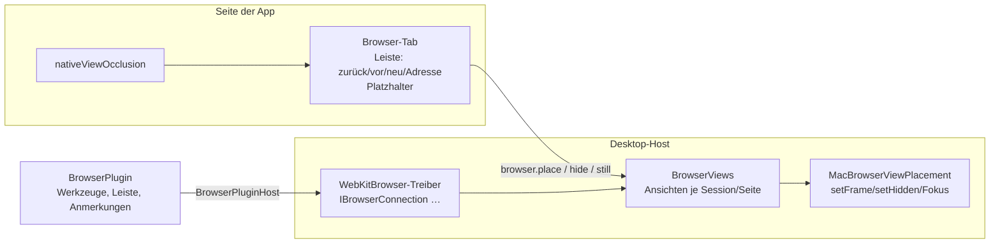

# Browser von CodeAlta als Tab neben der Session

Heute öffnet der Eintrag **Browser** einer Session einen echten Chrome/Edge/Firefox. Ziel: dieselbe Seite **in CodeAlta**, als Tab der Dock-Ansicht. Man teilt die Timeline („Rechts teilen“), der Browser steht rechts daneben, die Breite zieht man am Splitter – wie bei Terminal, Editor oder Änderungen. Die CodeAlta-Leiste (Anmerkungen) und die Werkzeuge des Agenten laufen dort wie im externen Browser.

Grundlage: der Versuch [2026-11-05-embedded-browser-spike](2026-11-05-embedded-browser-spike.md) (alle Fragen auf macOS beantwortet), die Annotationsarbeit dieses Branchs (`codealta-toolbar.js`, `IAnnotatablePage`, `BrowserPlugin`) und der Windows-Branch `origin/feature/embedded-browser` (nur gelesen).

## Grundsatz

Der eingebaute Browser ist **eine zusätzliche Option**. Die externen Browser (Chrome, Edge, Firefox) bleiben voll unterstützt und unverändert: Leiste, Anmerkungen, Quellenhinweise aus DevTools und alle Werkzeuge des Agenten funktionieren dort weiter wie heute. Gemeinsame Teile (Leiste, Anmerkungen, Werkzeuge) hängen nur an den Treiber-Schnittstellen; jede Änderung daran wird mit dem CDP- und dem BiDi-Treiber geprüft (bestehende Tests müssen grün bleiben).

## Begriffe

- **Browser-Bereich**: ein Tab der CodeAlta-Dock-Ansicht, „Browser · ‹Session›“ – der Browser einer Session, wie ein Chrome-Fenster. Genau einer je Session, in welchem CodeAlta-Fenster er auch steht.
- **Browser-Tabs**: die Seiten im Browser-Bereich, mit eigener Tab-Leiste wie in Chrome – eine Website je Tab, beliebig viele (vom Nutzer, vom Agenten, von Popups der Seite geöffnet).

## Entscheidungen (vom Nutzer am 2026-11-05 bestätigt)

| # | Frage | Vorschlag | Warum |
| --- | --- | --- | --- |
| 1 | Wo der Browser lebt | **Ein Tab der Dock-Ansicht** (neue Art `browser` neben `terminal`, `editor` …), Titel „Browser · ‹Session›“: der **Browser-Bereich**, einer je Session, darin die **Browser-Tabs** der Session mit eigener Tab-Leiste. Öffnen setzt ihn **rechts neben** den Tab der Session; danach verschieben, teilen, Größe ziehen wie jeder Tab – **auch in ein zweites CodeAlta-Fenster herausziehen**, wo er wie jeder andere Tab steht (allein: der Browser füllt das Fenster). | Wunsch des Nutzers; die Dock-Ansicht (`flexlayout-react`, `sessionTabLayout.ts`) kann Teilen, Ziehen und Splitter schon. Der Windows-Branch baute einen eigenen Teil mit eigenem Splitter – das entfällt. |
| 2 | Wie er gewählt wird | Neuer Browser **„CodeAlta (eingebaut)“** in der Browser-Wahl, **zusätzlich** zu Chrome/Edge/Firefox – kein Ersatz und nicht der Standard. Der Eintrag „Open the browser of this session“ öffnet den Browser-Bereich nur, wenn der eingebaute gewählt ist; sonst wie heute den externen Browser. | Ein Ort für die Wahl; Agent, Leiste und Startseite bleiben dieselben. |
| 2b | Der Knopf „Browser“ der Session | **Split-Button**: der große Teil öffnet den Browser, wie er in den Einstellungen gewählt ist; das Caret öffnet eine Liste der **anderen** verfügbaren Browser (eingebaut, Chrome, Edge, Firefox – was installiert ist, ohne den gewählten), die diese Session einmal damit öffnet, ohne die Einstellung zu ändern. Ist der Browser der Session schon offen, bringt der große Teil ihn nach vorn. | Wunsch des Nutzers; die Einstellung bleibt der Standard, die Ausnahme ist einen Klick entfernt. |
| 2c | Ein anderer Browser, während einer offen ist | Eine Session hat **einen** Browser zur Zeit. Wählt man im Caret einen anderen, **fragt CodeAlta nach** (Nutzer: „fürs Erste fragen, dann schauen, wie sich das anfühlt“), schließt dann den offenen und öffnet die Adressen seiner Browser-Tabs im neuen. Offene Anmerkungen bleiben der Session. | Agent und Leiste kennen je Session einen Browser (`BrowserAgentSession`); zwei gleichzeitig wäre ein anderes Modell. |
| 3 | Wie er angetrieben wird | **Dritter Treiber** `WebKit` hinter `IBrowserConnection`/`IBrowserContext`/`IBrowserPage`/`IAnnotatablePage`, im Desktop-Projekt (er braucht NeoAstra), dem Plugin über `BrowserPluginHost` gegeben. | Die Werkzeuge (`BrowserTools`), die Leiste und die Anmerkungen arbeiten nur gegen diese Schnittstellen. |
| 4 | Plattform | **macOS zuerst** (WKWebView). Windows danach mit den Teilen des Windows-Branchs (WebView2, Platzierung über COM); Linux nicht. | Der Versuch hat macOS geklärt. |
| 5 | Menüs und Dialoge über der Seite | Erste Version: **Standbild** (16 ms in der App gemessen) an Stelle der Ansicht, solange eine Überlagerung sie kreuzt; Signal aus `nativeViewOcclusion.ts`. Später: „Unterlage“ (Seite unter der App, durchsichtiger Platzhalter, Durchklicken). | Standbild ist erprobt und plattformneutral; die Unterlage braucht Layout-Arbeit und einen Eingriff in NeoAstras Klasse. |
| 6 | NeoAstra | Was NeoAstra 1.12 nicht kann (Platzieren/Verbergen/Fokus einer Ansicht, isolierte Welt mit Kanal), macht **eine Klasse** über die Objective-C-Laufzeit am geborgten `WKWebView*`, wie im Versuch. Ein Vorschlag an NeoAstra kommt nach dem Gespräch mit dem Nutzer und ersetzt diese Klasse. | Kein Warten auf eine neue NeoAstra-Version. |
| 7 | Speicher und Cookies | Eine NeoAstra-Umgebung „browser“ (eigener `UserDataRoot`, ohne `app:`-Schema, ohne Bridge). `Isolated = true` → eigener `WKWebsiteDataStore` je Session (nicht persistent); sonst der gemeinsame Speicher der Umgebung. **Nie** ein Profil der App-Umgebung (teilt Daten, erreicht `app:`). | Ergebnis Frage 3 des Versuchs. |

## Was der eingebaute Browser kann – und was nicht

| Werkzeug / Teil | Eingebaut (WebKit) |
| --- | --- |
| Navigieren, zurück/vor, neu laden, Tabs öffnen/schließen | ja (NeoAstra) |
| Snapshot, Klick, Tippen, Tasten, Ziehen | ja; Agent-Skript in eigener Welt, Eingaben als **native** Ereignisse an die Ansicht (`isTrusted` true) |
| Bildschirmfoto, Bild eines Bereichs | ja, auch bei verborgener Ansicht (`CaptureAsync`); ganze Seite nein |
| Skript auswerten, Init-Skripte | ja |
| JavaScript-Dialoge | ja (`ScriptDialogRequested`), im Tab angezeigt und vom Agenten beantwortbar |
| Konsole | ja, über ein Skript der Seite (Nachrichten der Seite, nicht des Browsers) |
| Netzwerk | eingeschränkt: Liste aus `PerformanceObserver`, ohne Körper und Header |
| Dateien hochladen | nein im ersten Schritt (kein Weg, `input[type=file]` ohne Dialog zu füllen) |
| Emulation | User-Agent, Farbschema; keine Gerätegröße, keine Drosselung |
| Traces, Heap-Snapshot | nein (`Capabilities` false) |
| Leiste, Anmerkungen, Bild der Anmerkung | ja; Quellenhinweise nur aus Text/Selektor/Stylesheet derselben Herkunft, keine CSS-Zeilen, keine Stacks |
| Sandbox-Proxy, gesperrte Ports | Proxy über `WKWebsiteDataStore.proxyConfigurations` (macOS 14+); Ports von CodeAlta über Navigationsregel und Content-Rule-List – in Phase 3 prüfen |

## Aufbau

- **Host** (`src/CodeAlta/Desktop/Browser/`): `BrowserViews` besitzt die WKWebViews (Einzelschreiber auf dem UI-Thread). Eine Ansicht gehört der **Session**, nicht dem Tab und nicht einem Fenster: das Fenster, dessen Seite den Tab zeigt, meldet die Platzierung mit dem Label seiner Ansicht, und der Host hängt den `WKWebView` in dessen `contentView` um (`removeFromSuperview`/`addSubview:` – im Versuch ohne Neuladen, mit Eingaben und Skriptzustand erhalten). Beim Verschieben eines Tabs (`DesktopWindows.MoveTabAsync`: die Quelle schließt, das Ziel öffnet) verbirgt das Schließen die Ansicht nur; erst das Schließen des Browsers oder der Session beendet sie. Ein Browser-Bereich je Session in allen Fenstern zusammen; seine Browser-Tabs (Seiten) wandern mit ihm. `MacBrowserViewPlacement` platziert sie (Punkte = CSS × Zoom, `convertRect:toView:`, Maske `NSViewMinYMargin`), gibt Fokus und nimmt das Standbild. `WebKitBrowser` setzt die Treiber-Schnittstellen darauf um; die Welt-Brücke (`WKContentWorld`, Nachrichtenkanal, Auswerten mit Antwort) liegt in einer Interop-Klasse.
- **Seite** (`frontend/src/browser/`): Tab-Art `browser` in `fileTabs.ts`/`sessionTabLayout.ts`; `BrowserTab` mit Leiste und Platzhalter, misst ihn (`ResizeObserver` + Bild für Bild) und meldet Rechteck, Sichtbarkeit und Überlagerung über RPC. `nativeViewOcclusion.ts` und `browserPlacement.ts` aus dem Windows-Branch (Einheit für macOS angepasst).
- **Plugin**: `BrowserPluginHost` bekommt eine Quelle für eingebaute Browser; `BrowserPool` behandelt das Ziel „CodeAlta (eingebaut)“ wie einen Browser ohne Prozess.
- **Fensterautomation**: `PageFilter` auf die Ansicht des Fensters, damit `alta ui` und `codealta-dev` die Browser-Seiten nicht sehen (im Versuch gesehen).

## Schritte

### Phase 1: Die Ansicht im Tab (sichtbar, ohne Agent)
- [x] 1.1 Host: `BrowserViews` + `MacBrowserViewPlacement` (erzeugen auf dem Hauptfenster, platzieren, verbergen, Fokus, Standbild), Umgebung „browser“ mit Navigationsregeln, Rechten, Downloads wie im Windows-Branch; `PageFilter` der Fensterautomation. Tests mit Fake-Platzierung.
- [x] 1.2 RPC `browser.*` (öffnen, schließen, navigieren, zurück/vor/neu, platzieren, verbergen, Standbild, beobachten) mit getyptem Client.
- [x] 1.3 Seite: Tab-Art `browser`, `BrowserTab` (Tab-Leiste der Browser-Tabs mit **+** und Schließen, Adressleiste, Platzhalter), Öffnen rechts neben dem Session-Tab, Wiederherstellen nach Neustart. Tests: Layout, Platzierung, Browser-Test des Tabs.
- [x] 1.4 Überlagerung: `nativeViewOcclusion.ts` übernehmen, Standbild bei Kreuzung; Toasts weichen aus. Tastatur: Klick in die Seite gibt sie ihr, Verbergen gibt sie der App zurück.
- [x] 1.4b Zweites Fenster: der Tab lässt sich in ein neues oder anderes CodeAlta-Fenster ziehen und zurück; die Ansicht wechselt das Fenster ohne Neuladen; ein Fenster, das schließt, nimmt sie nicht mit (sie wird verborgen, der Tab kehrt wie andere Tabs zurück oder schließt); Fokus und Standbild im richtigen Fenster.
- [x] 1.5 Sichtprüfung in der Developer-Instanz (2026-11-06 dazu gesehen: Splitter ziehen – die Ansicht folgt sofort; helles Theme; Zoom 125 % – die Ansicht sitzt richtig; 900×650 – passt, Leiste unten rechts; Herauslösen in ein zweites Fenster und zurück ins Hauptfenster mit `alta window tab move`. Für den Nutzer von Hand: Tippen in die Seite, Vollbild. 2026-11-05 gesehen: Öffnen über `/browser` rechts neben der Session, Adresse laden, Einstellungsdialog über dem Browser, Verschieben in ein neues Fenster ohne Neuladen; offen: Splitter ziehen, zurück ins Hauptfenster, helles Theme, 900×650, Zoom der App, Tastatur von Hand): Teilen, Splitter, Verschieben, Herausziehen in ein zweites Fenster und zurück, Session-Wechsel, Menü/Dialog/Toast, beide Themes, 900×650, Zoom der App, Vollbild.

Commits: `dca7288e3` (Host, RPC, 30 Tests), `99e841d93` (Tab, Hub, Überdeckung, Fenster). Abweichung vom Windows-Branch: kein eigener Splitter und kein Vorab-Standbild – die Dock-Ansicht teilt und zieht, und WebKit nimmt das Bild einer verborgenen Ansicht in wenigen Millisekunden im Moment der Überdeckung. Befehl im ersten Schritt: `/browser` (Befehlssuche); der Split-Button kommt mit 2.2b.

### Phase 2: Treiber und Werkzeuge des Agenten
- [x] 2.1 `WebKitBrowser` (`IBrowserConnection`, `IBrowserContext`, `IBrowserPage`): Navigation, Auswerten, Agent in eigener Welt (`CallAgentAsync`), native Eingaben, Bild, Dialoge, Konsole, Netzwerk (eingeschränkt), Größe/Emulation soweit möglich; nicht Mögliches mit klarer Meldung.
- [x] 2.2 `BrowserPluginHost`/`BrowserPool`/Browser-Wahl: Ziel „CodeAlta (built-in)“ (`codealta`), nie automatisch gewählt, nicht für das Nutzerprofil. Offen daraus: der Eintrag **Browser** öffnet den Tab (mit 2.2b).
- [x] 2.2b Split-Button (`d58470de4`; Sichtprüfung offen, Bildschirm war gesperrt): `PluginStatusItem` bekommt eine kleine, allgemeine Erweiterung – Alternativen fürs Caret (Bezeichnung, Befehl, Argument), mit XML-Doku und Tests; der Desktop zeigt ein Status-Element mit Alternativen als Split-Button (die TUI zeigt nur den Hauptbefehl). Das Browser-Plugin füllt die Liste aus den installierten Browsern ohne den gewählten; der Befehl nimmt den Browser als Argument; Wechsel nach 2c.
- [x] 2.3 Werkzeugtests gegen den Treiber (Fake der Ansicht, wo nötig) und ein Lauf eines Agenten in der Developer-Instanz. Agentenläufe in der Developer-Instanz mehrfach (navigate, snapshot, click_at, type_text, press_key, evaluate_script, screenshot, Leiste). Automatische Tests decken DesktopBrowsers, Hub, Plugin-Wahl ab; der WebKit-Treiber selbst braucht ein echtes WKWebView und hat keine Unit-Tests.

Stand 2026-11-05: `af9ef7dfa` (Budget der Kanäle: kein `watch`, die Seite fragt den Zustand ab), `faf5a5fa0` (Treiber). In der Developer-Instanz hat ein Agent (`claude-opus-5-5`, 11 Werkzeugaufrufe) im sichtbaren Browser-Tab aktiviert, geladen, Snapshot genommen, zweimal geklickt, ein Feld gefüllt, ein Skript ausgewertet, ein Bildschirmfoto gemacht und die Konsole gelesen – alles erfolgreich. Noch offen: JavaScript-Dialoge der Seite im Tab zeigen (heute wartet die Seite, bis ein Agent antwortet), Tastatur, wenn die Ansicht verborgen ist, Frames.

### Phase 3: Leiste und Anmerkungen
- [x] 3.1 `IAnnotatablePage` für WebKit (`cf57c7f78`): Leiste in Welt `codealta-toolbar` (Vorspann für das Binding, `codealta-toolbar.js` unverändert), Aufrufe in der Welt, Bild über `CaptureAsync`, `InspectAsync` mit Skript-Hinweisen, Dokumentzähler statt `ContextId`.
- [x] 3.2 Sandbox: Proxy und gesperrte Ports prüfen und umsetzen oder als Grenze dokumentieren. Umgesetzt: eine Sandbox-Session nutzt den eingebauten Browser nie (benannt: Absage; in den Einstellungen bevorzugt: automatische Wahl ohne ihn; der Treiber lehnt einen Kontext mit Proxy ab). Dokumente und Frames erreichen die Ports von CodeAlta nicht (`BrowserAddress.IsReserved` in der Navigationsentscheidung); Teilanfragen (fetch, Bilder) sieht WKWebView nicht – der MCP-Server prüft Host, Origin und Token ohnehin.
- [x] 3.3 Prüfung: Anmerkung anlegen, an die Session senden, Gegenprobe der Seite. Teilweise am 2026-11-05: ein Agent hat auf einer Seite des Projekts (Python-Server mit dem Projektordner als Arbeitsordner) die Leiste gesehen, **Annotate** und ein Element mit `click_at` gewählt, die Notiz getippt und mit Meta+Enter gespeichert – Zähler 1, **Send** aktiv. Die Gegenprobe der Seite meldet „abgewiesen“. Am Morgen danach im sichtbaren Tab gesehen: die Marke „1“ sitzt richtig auf dem Element, die Leiste unten rechts (die Verschiebung kam von der verborgenen Ansicht in Ersatzgröße). Split-Button gesehen: Caret mit „CodeAlta (built-in)“. 2026-11-06: Senden geprüft – der Agent nimmt den eingebauten Browser, den der Nutzer neben der Session zeigt („shown beside the session“, gilt als vom Nutzer geöffnet: Leiste auf jeder Seite); Anmerkung → Zähler 1 → die Anmerkung wartet über dem Prompt („1 annotation from the browser“) → mit dem Prompt gesendet, der Agent nennt Element, Selektor, Seite und Notiz. **Beobachtung:** Send in der Leiste während eines laufenden Turns meldete „sent“, die Anmerkung kam aber nirgends an (kein Steer, keine Warteschlange, kein Turn danach); der Weg (Plugin → Composer → Warteschlange) ist derselbe wie für Chrome und nicht Teil dieser Arbeit – Send bei ruhender Session von Hand prüfen. JavaScript-Dialoge im Tab (alert/confirm/prompt) am 2026-11-06 umgesetzt und in der Developer-Instanz geprüft: prompt → „Grace“, confirm → true, alert mit dem Ergebnis; die Seite zeigt `prompt="Grace" confirm=true`.

### Phase 4: Abschluss
- [x] 4.1 Doku: `site/docs/browser.md` (eingebauter Browser, Grenzen), `doc/` nur wenn sich Grenzen der Architektur ändern.
- [x] 4.2 Alle .NET-Tests, `npm test`, `lunet build`; Anmerkungen einmal im externen Chrome nachprüfen (unverändert). 2026-11-06: .NET alle bestanden (ein Test in CodeAlta.Tests nur unter der Last des Gesamtlaufs rot, allein zweimal grün); `npm test` 0 Fehler; `lunet build` ohne Fehler; Chrome-Anmerkungen durch den Plugin-Test mit echtem Chrome (`TheUserOpensTheBrowserOfASession…`).

### Später (nicht in diesem Plan)
- Unterlage statt Standbild; Kürzel der App weiterleiten, während die Seite die Tastatur hat; Windows (WebView2) aus dem Windows-Branch; Vorschlag an NeoAstra.

## Risiken

| Risiko | Umgang |
| --- | --- |
| Interop am geborgten `WKWebView*` bricht NeoAstras Annahmen | eine Klasse, geprüft in der Developer-Instanz; ersetzt durch NeoAstra-API, sobald vorhanden |
| Auswerten in einer eigenen Welt braucht einen Objective-C-Block als Rückruf | Block-Brücke in der Interop-Klasse, oder Antwort über den Kanal der Welt (im Versuch erprobt) |
| Umhängen zwischen Fenstern an NeoAstra vorbei (NeoAstra kennt die Ansicht als Kind des Hauptfensters) | im Versuch ohne Fehler; Schließen eines Fensters, Bildschirmwechsel und Retina-Faktor je Fenster in 1.4b prüfen; Ausweg: eine Ansicht je Fenster, die die Adresse neu lädt |
| Überlagerungen, an die niemand dachte, liegen unter der Seite | ein Signal, die Selektoren des Windows-Branchs, Standbild; neue Überlagerungen nutzen die gemeinsamen Bausteine |
| Werkzeuge mit weniger Möglichkeiten als in Chrome | `Capabilities` und klare Meldungen; der externe Browser bleibt wählbar |
| Seiteninhalte als Einfallstor für Prompt-Injection | wie heute: Kennzeichnung, Anmerkungen nur aus der Leiste in eigener Welt |
